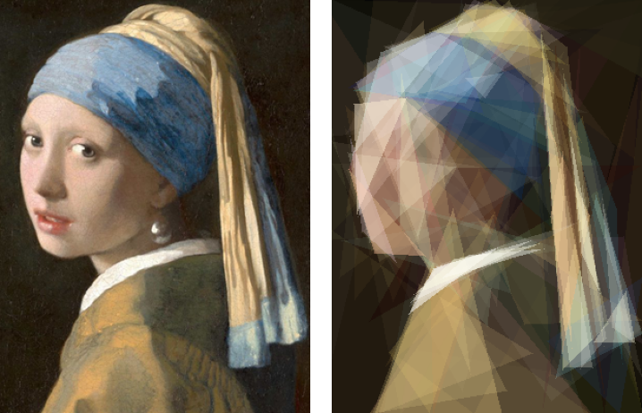
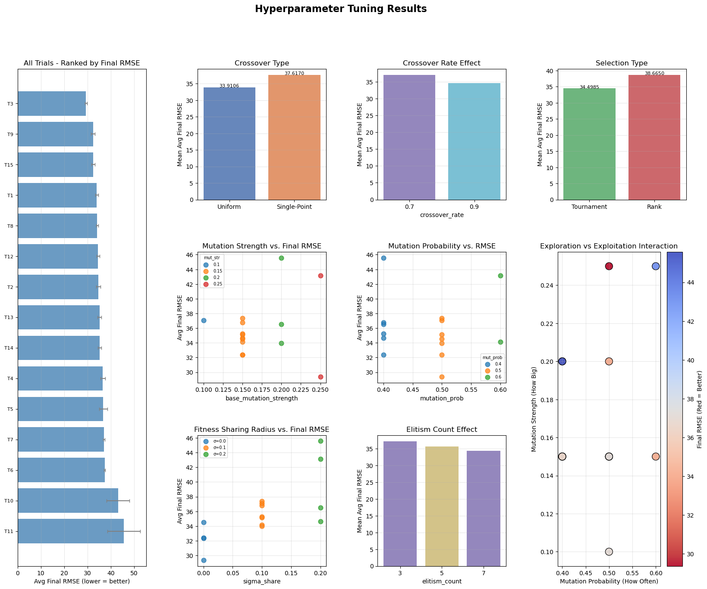
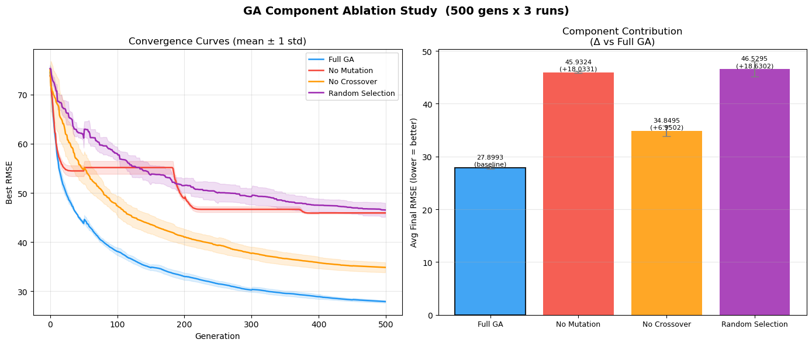
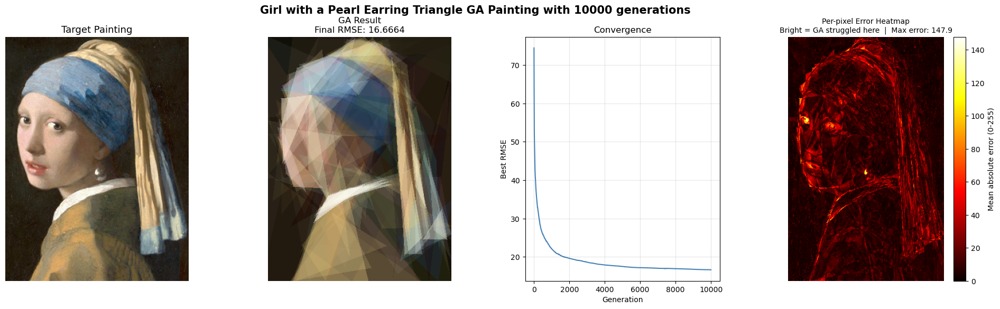

# Genetic Painting

A genetic algorithm that recreates Vermeer's _Girl with a Pearl Earring_ using only **100 semi-transparent triangles**.

<p align="center">
  
  <br>
  <em>Left: the target painting. Right: the best individual after 10,000 generations (RMSE 16.67).</em>
</p>

Built as a group project for the Computational Intelligence for Optimization course of the MSc in Data Science and Advanced Analytics at NOVA IMS (2025/26).

## How it works

**Genome.** Each individual is a flat `float32` array of 1,000 genes: 100 triangles × 10 values (three vertices, RGB colour and alpha).

**Fitness.** The triangles are drawn in order with alpha blending, and fitness is the root mean squared error (RMSE) between the drawing and the target, pixel by pixel. Lower is better.

**Fast rendering.** Drawing every individual every generation is the bottleneck, so the renderer is compiled with **Numba** and runs in parallel, and each triangle only loops over its own bounding box instead of the whole image. A full 10,000-generation run with a population of 200 takes about 22 minutes on a CPU.

**Mutation on triangles, not numbers.** Six operators act on whole triangles:

| Operator      | Probability | Effect                                           |
| ------------- | ----------- | ------------------------------------------------ |
| Vertex jitter | 30%         | Moves one corner slightly                        |
| Translation   | 20%         | Shifts the whole triangle                        |
| Rotation      | 20%         | Rotates it around its centre                     |
| Edge stretch  | 15%         | Pulls one corner towards or away from the centre |
| Colour shift  | 10%         | Changes brightness and warmth together           |
| Alpha shift   | 5%          | Makes it more or less transparent                |

Mutation strength scales with the triangle's area and decays over the run.

**Selection and crossover.** Tournament or rank-based roulette selection, uniform or single-point crossover over the list of triangles, and elitism, all set by parameters.

**Keeping the search moving.** Optional fitness sharing penalises near-identical individuals. When progress stalls, the worst 20% of the population is replaced by heavily mutated copies of the best individual. Every 100 generations, each individual's triangles are re-sorted so large shapes are drawn first and details sit on top.

## Tuning

A random search tried 15 configurations, each run 3 times for 500 generations, and the best one was used for the final run: tournament selection (k = 5), uniform crossover at rate 0.7, mutation probability 0.5 and an elite of 7.



## Ablation study

To see what each part contributes, the best configuration was re-run with one component disabled at a time (3 runs × 500 generations each):

| Condition        | Average final RMSE | Change vs full GA |
| ---------------- | ------------------ | ----------------- |
| Full GA          | 27.90              | —                 |
| No crossover     | 34.85              | +6.95             |
| No mutation      | 45.93              | +18.03            |
| Random selection | 46.53              | +18.63            |

Selection pressure and mutation drive most of the progress: without either, the final error is about 65% higher. Crossover still gives a clear gain.



## Where it struggles

The per-pixel error map shows the GA does well on large, smooth regions like the background and the shoulder, and worst on small, high-contrast details such as the eyes and the pearl, and along sharp edges. With only 100 triangles, each one is too valuable to spend on a few pixels.



## Running it

```bash
pip install -r requirements.txt
jupyter notebook genetic_painting.ipynb
```

The target image is included at `data/target.png` (300 × 400 pixels; Vermeer's painting is in the public domain). To use another image, replace that file with any 300 × 400 picture. The random search and the final run each take a while; lower `FINAL_GENERATIONS` and `n_trials` for a quick test.
